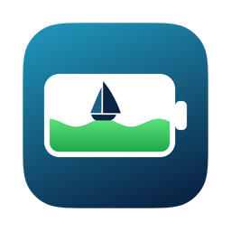
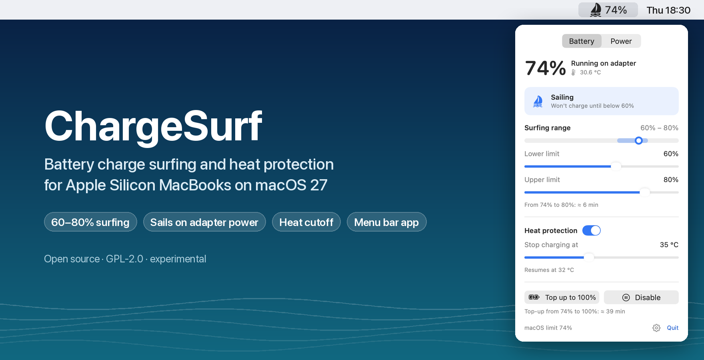
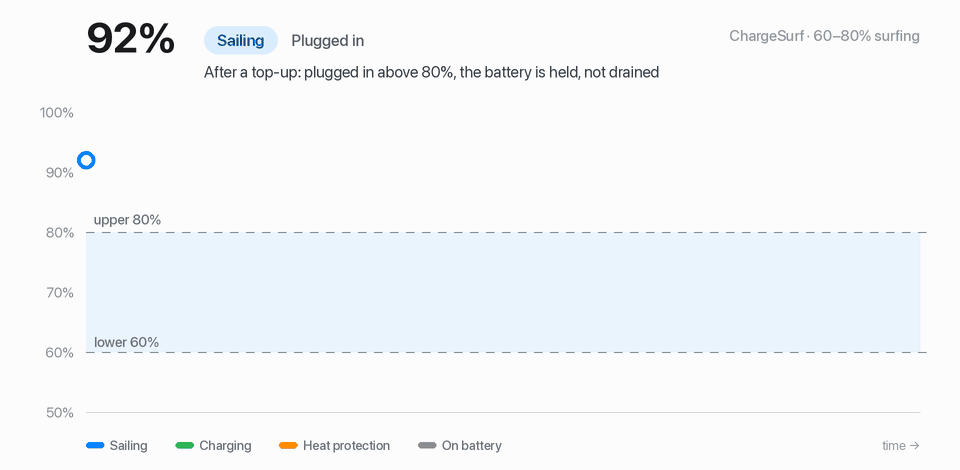
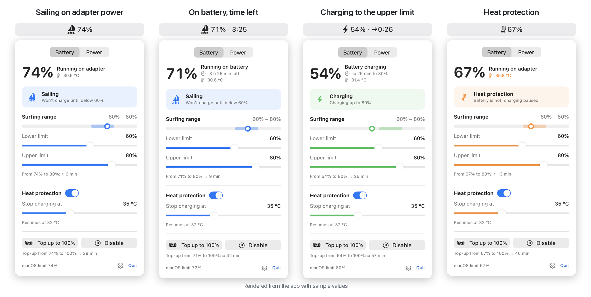
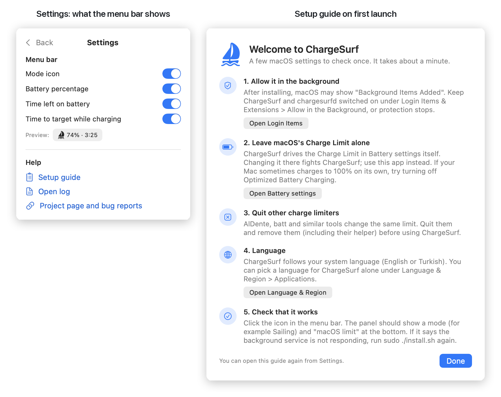
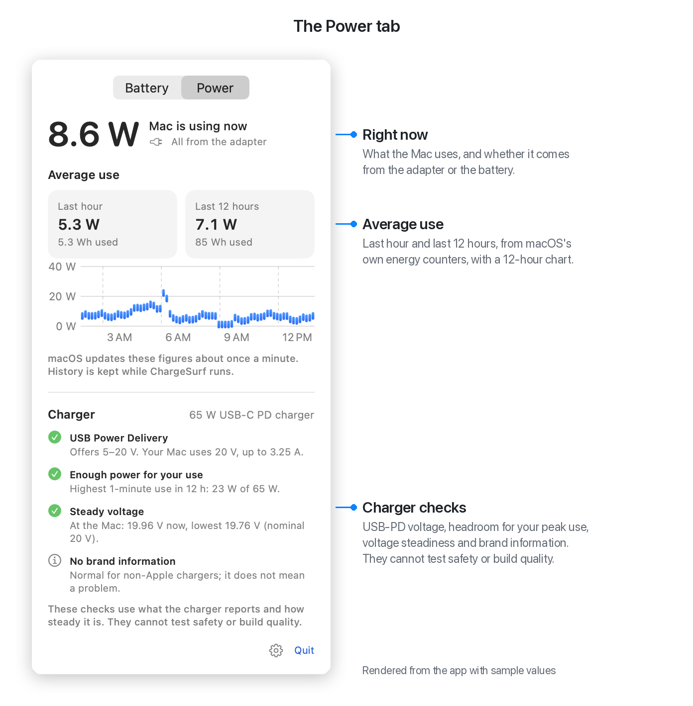
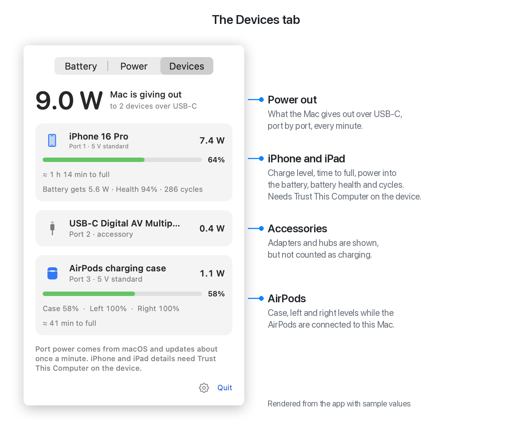

<p align="center"></p>

# ChargeSurf: free battery charge limiter for MacBooks on macOS 27



**ChargeSurf** is a free, open-source **battery charge limiter for Apple Silicon MacBooks** (MacBook Air and MacBook Pro) on **macOS 27**. It keeps the battery between a lower and an upper limit you choose (60-80% by default) to reduce battery wear, holds the charge on adapter power instead of topping it up, pauses charging when the battery gets hot, and shows power use, charger details and USB-C device charging in a small menu bar app (English and Turkish).

[Install](#install) · [Project page](https://mirakoz.github.io/ChargeSurf/) · [Download](https://github.com/mirakoz/ChargeSurf/releases) · [vs. macOS Charge Limit](#chargesurf-vs-the-macos-charge-limit) · [FAQ](#faq) · [Türkçe](#türkçe)

> [!WARNING]
> **Experimental. Tested on a single machine only.**
> ChargeSurf has been run on exactly one Mac: a **MacBook Pro with Apple M5 on macOS 27.0 (build 26A428)**. Short checks on that machine passed: the limit is applied and registered by macOS, heat protection triggers and releases, top-up and disable release and restore the limit, and settings changes (written the same way the app writes them) are picked up within about a second. The menu bar app has been used by hand on that machine. It has **not** been tested over days of real use, across sleep cycles, through a full 60-80% charge cycle, on other Macs, or on other macOS builds.
> It relies on a **private macOS API** (PowerUI) that Apple can change or remove in any update. Expect bugs and errors. Use it at your own risk; there is no warranty (see [LICENSE](LICENSE)). Bug reports are very welcome.

## What it does



- **Surfing (hysteresis):** when the battery drops **below the lower limit** (default 60%), it charges up to the **upper limit** (default 80%). In between, it does not top up.
- **Sailing:** after reaching the upper limit, the charge limit follows the current percentage and only ever goes down. While plugged in, the Mac runs from the adapter: it neither charges nor drains the battery. Unplug, use it down to 70%, plug back in: it stays at 70%. This also holds **above** the upper limit: after a top-up, or if you lower the upper limit, ChargeSurf keeps the current level on adapter power instead of draining the battery down to the limit, and surfing continues once the battery comes down naturally.
- **Heat protection:** when the hottest battery sensor reaches **35 °C** (configurable), charging is paused at the current percentage; it resumes at **32 °C**.
- **Top up to 100%:** removes the limit for a trip and turns itself off at 100%. From there it sails: plugged in, the battery is held, not drained, until it comes down below the lower limit.
- **Disable:** hands charging back to macOS defaults.
- **Menu bar app:** percentage, charging state, temperature, mode and the limit macOS is enforcing; sliders for the range and the heat threshold. Settings apply within about a second. Protection keeps running when the app is closed.
- **Time estimates:** how long charging to your upper limit or to 100% would take, and time left on battery. Estimates use the measured charging current (learned below 80%) or, before the first charge, the adapter's power; charging above 80% is assumed to be slower. Treat them as approximate.
- **Customizable menu bar:** choose what the menu bar shows (mode icon, percentage, time left on battery, time to target while charging) in the app's Settings.
- **Power tab:** what the Mac uses right now and whether it comes from the adapter or the battery, the average use over the last hour and the last 12 hours with a chart, and the connected charger: the voltages it offers over USB Power Delivery, what your Mac negotiated, and a few checks (headroom for your peak use, voltage steadiness, brand information). The checks only use what the charger reports and how steady it is; they cannot judge safety or build quality.
- **Devices tab:** what the Mac powers over its USB-C ports, port by port: the watts and voltage going out, and for an iPhone or iPad its charge level, an estimated time to full, the power going into its battery, battery health and cycle count. AirPods in a USB-C case show case, left and right levels while they are connected to the Mac. Adapters and hubs are listed but not counted as charging. Optionally, a notification when a device finishes charging (on by default, in Settings).
- **Setup guide:** opens on first launch (and from Settings) with the macOS settings to check, each with a button that opens the right System Settings pane.

### The menu bar app

<picture>
  <source media="(prefers-color-scheme: dark)" srcset="docs/images/states-dark.png">
  
</picture>

<picture>
  <source media="(prefers-color-scheme: dark)" srcset="docs/images/settings-guide-dark.png">
  
</picture>

<picture>
  <source media="(prefers-color-scheme: dark)" srcset="docs/images/power-dark.png">
  
</picture>

<picture>
  <source media="(prefers-color-scheme: dark)" srcset="docs/images/devices-dark.png">
  
</picture>

The images are rendered from the app with sample values (`docs/make-images.sh` regenerates them).

## ChargeSurf vs. the macOS Charge Limit

Since macOS 26.4, System Settings > Battery has its own **Charge Limit**. ChargeSurf drives the same macOS mechanism underneath and adds what the built-in setting does not offer:

| | macOS Charge Limit | ChargeSurf |
| --- | --- | --- |
| Upper limit | 80-100% in 5% steps | any value from 20% to 99% |
| Lower limit (charge only after the battery drops below it) | no | yes, from 10% |
| Pause charging when the battery is hot | no setting | yes, threshold adjustable |
| Top up to 100% once, then go back to the limit | move the slider by hand | one click, turns itself off at 100% |
| Power use, charger (USB-PD) details, USB-C device charging | no | yes, in the menu bar app |
| Price | free, built in | free, open source (GPL-2.0) |

Use one or the other. Both write the same macOS setting, so while ChargeSurf runs, don't change the built-in Charge Limit (ChargeSurf's log warns if something else changes the limit).

## How it works (and why this way)

On macOS 27 release builds, the SMC charge-control keys that tools like AlDente and batt used (`CH0B`/`CH0C`/`CHTE`, and the firmware-limit keys `bfF0`/`bfD0`/`bfE0`) are gated behind a private entitlement. They return `kIOReturnNotPrivileged` **even to root** (verified on the test machine).

What still works is **macOS's own charge limit**. A root daemon (`chargesurfd`) writes an exact target (10-99%) into PowerUIAgent's preference domain (`com.apple.smartcharging.topoffprotection`) and posts the reload notification. ChargeSurf moves that single upper target around to implement surfing, sailing and heat protection. This mechanism comes from [charlie0129/batt](https://github.com/charlie0129/batt).

Consequences you will notice:

- If the battery is **above** the limit, macOS drains it toward the limit **even while plugged in**. ChargeSurf avoids this by never setting the limit below the current percentage. macOS limits stop at 99%, so at 100% (after a top-up) ChargeSurf releases the limit instead; macOS may then keep the battery at 100% while plugged in, and sailing continues from 99% once it drops.
- When a limit is applied again after it was released (turning **Disable** off, or stopping a top-up, while the Mac is charging), macOS runs from the battery for roughly 40-60 seconds before settling, whatever the target is (observed: about 0.6 A, around 0.1% of the battery). This is macOS behavior that ChargeSurf cannot avoid. Normal surfing and sailing, and a top-up that finishes at 100%, do not trigger it.
- A new limit can take **a minute or a few minutes** to take effect, especially while charging. For the first 5 minutes after it starts sailing, ChargeSurf lets the limit follow such an overshoot upward instead of draining it back.
- After about **5 minutes on battery**, macOS withdraws the limit and re-applies it when you plug in again.
- The limit is stored by macOS, so it stays in force during sleep. Switching from sailing to charging needs the daemon to be awake.
- The **Power tab** reads macOS's battery driver (`AppleSmartBattery`: `PowerTelemetryData` and `AdapterDetails`), which needs no root. macOS adds the system load to a running counter about once per second and publishes it about once a minute. The menu bar app stores one reading per minute for 24 hours in `~/Library/Application Support/ChargeSurf/power-history.csv` and computes averages from the differences, so they also cover time the app was closed, but not across a restart.
- The **Devices tab** reads the power going out of each USB-C port from the same driver (`PowerOutDetails`, also about once a minute) and matches it to the USB device on that port through the port's `usb-c-port-number`. iPhone and iPad details come from Apple's private MobileDevice framework (the one Finder uses), through the battery values the device shares and its diagnostics service, only for devices that already trust this Mac; ChargeSurf never asks a device to trust it. AirPods levels come from `system_profiler SPBluetoothDataType`, which needs no Bluetooth permission, and are read only while an AirPods case is plugged in.
- macOS's own **Battery > Charge Limit** setting in System Settings uses the same mechanism. Leave it alone while ChargeSurf runs; the log will warn if something else changes the limit.

## Requirements

- Apple Silicon MacBook
- **macOS 27 or later** (the app itself needs macOS 15+) (the installer checks and refuses otherwise, without changing anything)
- Xcode Command Line Tools (`xcode-select --install`), only when building from source
- An administrator account
- Quit **AlDente**, **batt** or any other charge limiter first. Two tools will fight over the same limit.

## Install

```bash
git clone https://github.com/mirakoz/ChargeSurf.git
cd ChargeSurf
./build.sh            # builds the daemon, the probe tool and the app into ./build
sudo ./install.sh     # installs and starts the daemon (checks macOS support first)
./install-app.sh      # installs the menu bar app to /Applications, starts at login (no sudo)
```

**Prebuilt download:** each [release](https://github.com/mirakoz/ChargeSurf/releases) also has a zip with the files already built, for those who would rather not build. They are not signed or notarized by Apple (that needs a paid developer account), so macOS blocks them until you clear the download mark yourself. Only do this if you trust the files:

```bash
cd ~/Downloads/ChargeSurf-0.2.0
xattr -dr com.apple.quarantine .   # you are telling macOS you trust these files
sudo ./install.sh
./install-app.sh
```

## Usage

The menu bar app covers everyday use. From the terminal:

```bash
/Library/Application\ Support/ChargeSurf/chargesurfd status    # sudo for full output
cat "/Library/Application Support/ChargeSurf/status"            # what the daemon last did
tail -f /Library/Logs/ChargeSurf.log                            # log (changes only, summary every 30 min)
pmset -g battlimit                                              # the limit macOS has registered
```

Settings live in `/Library/Application Support/ChargeSurf/config` (owned by `root:admin`, mode 664, so the app can write it without a password):

| key | default | meaning |
| --- | --- | --- |
| `lower` | 60 | start charging below this percentage |
| `upper` | 80 | charge up to this percentage (max 99) |
| `heat_protection` | 1 | 1 = on, 0 = off |
| `heat_stop` | 35 | pause charging at this battery temperature (°C) |
| `heat_resume` | 32 | resume below this temperature (the app keeps it 3 °C under `heat_stop`) |
| `interval` | 30 | seconds between checks |
| `full_charge` | 0 | 1 = top up to 100%; turns itself back to 0 at 100% |
| `disabled` | 0 | 1 = release the limit and do nothing |

## Uninstall

```bash
sudo ./uninstall.sh   # stops the daemon, releases the macOS limit, removes the app (keeps the log)
```

## Tested on

| Mac | Chip | macOS | Result |
| --- | --- | --- | --- |
| MacBook Pro (Mac17,2) | Apple M5 | 27.0 (26A428) | Works in short tests; long-term use not yet verified |

If you try it on another Mac, please open an issue with your model, `sw_vers` output, `sudo .../chargesurfd status`, and the relevant part of the log, whether it worked or not. `build/smc-probe CH bf TB` lists the charge-related SMC keys on your machine.

## Known limitations

- Upper limit is capped at 99%; 100% means "no limit" for macOS.
- Lowering the upper limit below the current percentage does not drain the battery; the new limit applies once the battery has come down on its own.
- Raising the upper limit while sailing does not start charging; the new value applies on the next charge cycle. Use **Top up** to charge now.
- The Power tab has been checked with one charger only (a third-party 65 W USB-C PD charger). Apple chargers also report a name, maker and firmware; most others do not. Other Macs may expose different telemetry keys.
- The Devices tab has been checked with one iPhone (iPhone 14 Pro Max) and one AirPods case (MagSafe Charging Case, USB-C). MobileDevice is a private framework and may change with macOS updates; if it does, only the iPhone and iPad details are lost. Time to full is an estimate, and AirPods report their levels in coarse steps, so their estimate takes a few minutes to appear.
- Temperature comes from the battery sensors `TB0T`-`TB2T` (fallback `B0AT`); other Macs may expose different keys.

## FAQ

### How do I limit my MacBook's battery charge to 80% (or lower) on macOS 27?

For a single cap at 80%, 85%, 90% or 95%, macOS's own setting is enough: System Settings > Battery, the ⓘ button next to Charging. For a cap below 80% (for example 60% or 70%), a range instead of a single cap, or heat protection, [install ChargeSurf](#install). Its default range is 60-80%.

### My charge limiter stopped working after the macOS 27 update. Why?

On macOS 27 release builds, the SMC charge-control keys that many charge limiters wrote directly are restricted to a private Apple entitlement: they return `kIOReturnNotPrivileged` even to root. A limiter now has to go through macOS's own charge limit, which is what ChargeSurf (and [batt](https://github.com/charlie0129/batt)) do. See [How it works](#how-it-works-and-why-this-way). Check first whether the tool you use has an update. If you switch to ChargeSurf, quit the other tool, because two limiters will fight over the same setting.

### Is ChargeSurf an AlDente alternative?

It has a similar core: a charge range, sailing on adapter power, heat protection and a one-time top-up, in a free, open-source app. It is not a copy of AlDente and does not try to cover everything AlDente offers.

### Which Macs does it support?

Apple Silicon MacBook Air and MacBook Pro models on macOS 27 or later. So far it has been tested only on a MacBook Pro with M5 (see [Tested on](#tested-on)); reports from other models are very welcome. It does not support Intel Macs or older macOS versions: the installer checks and stops without changing anything.

### Does it drain the battery while plugged in?

No. ChargeSurf never sets the limit below the current percentage, so on adapter power the Mac runs from the charger and the battery level is held. The one exception is a short macOS behavior when a limit is re-applied, described under [How it works](#how-it-works-and-why-this-way).

### Does the limit stay in force during sleep or when the app is closed?

Yes. The limit is stored by macOS itself, and protection runs in a background daemon, not in the menu bar app.

### Is it safe? What does it change on my Mac?

A root daemon writes the charge target into macOS's own charge-limit preference. It only reads the SMC (battery temperatures) and does not write SMC keys or firmware. It relies on a private macOS API that Apple can change in any update, so treat it as experimental. `sudo ./uninstall.sh` stops it and hands charging back to macOS.

### Is it free? Does it collect data?

Yes, it is free and open source under GPL-2.0. There is no account and no telemetry, and neither the app nor the daemon contacts any server (the only link the app opens is this page, in your browser).

## Credits

- [charlie0129/batt](https://github.com/charlie0129/batt) (GPL-2.0): the macOS 27 PowerUI charge-limit mechanism and the SMC key research ChargeSurf builds on. Its code also credits [az-code-lab/ampere](https://github.com/az-code-lab/ampere) for the native-limit preference mechanism.
- AlDente inspired the feature set (sailing, heat protection). No AlDente code or binaries were used or inspected.

ChargeSurf is not affiliated with Apple, AppHouseKitchen (AlDente) or the batt project.

## License

[GPL-2.0](LICENSE), the same license as batt, whose mechanism this project follows.

---

## Türkçe

ChargeSurf, macOS 27 çalıştıran Apple Silicon MacBook Air ve MacBook Pro'lar için ücretsiz ve açık kaynak bir **şarj sınırlayıcı** (charge limiter). Pil ömrünü korumak için şarjı seçtiğiniz iki sınır arasında tutar: "surfing" (%60'ın altına inince %80'e kadar şarj, arada şarja dokunmama) ve ısı koruması (batarya 35 °C'ye ulaşınca şarjı durdurma) sağlar. Prizdeyken Mac adaptörden çalışır, pil ne dolar ne boşalır. Menü çubuğu uygulaması Türkçe ve İngilizce, sistem diline göre açılır. Panelin **Güç** sekmesi Mac'in anlık tüketimini, son 1 ve 12 saatin ortalamasını ve takılı şarj aletinin bilgilerini (USB-PD voltajları, güç payı, voltaj kararlılığı) gösterir. **Cihazlar** sekmesi Mac'in USB-C portlarından şarj ettiği cihazları gösterir: her portun verdiği watt, iPhone ve iPad için doluluk, tahmini dolma süresi, pil sağlığı ve döngü sayısı, AirPods için kutu, sol ve sağ kulaklık seviyeleri. İstenirse cihaz tam dolunca bildirim gönderir.

**Deneysel:** Yalnızca tek bir Mac'te (Apple M5, macOS 27.0, 26A428) denendi. Uzun süreli kullanım, uyku döngüleri ve başka Mac'ler test edilmedi. Apple'ın özel bir API'sine dayandığı için macOS güncellemeleriyle bozulabilir. Hata çıkabilir, kullanım sorumluluğu kullanıcıya aittir.

Kurulum: yukarıdaki **Install** bölümündeki üç komut. Derlemek istemeyenler için [Releases](https://github.com/mirakoz/ChargeSurf/releases) sayfasında hazır derlenmiş bir zip var; Apple imzası olmadığı için macOS onu engeller, dosyalara güveniyorsanız `xattr -dr com.apple.quarantine .` ile engeli kendiniz kaldırırsınız. Kaldırma: `sudo ./uninstall.sh`.

### Sık sorulanlar

**MacBook şarjını %80'de (ya da daha aşağıda) nasıl durdururum?** Tek bir %80, %85, %90 veya %95 sınırı için macOS'in kendi ayarı yeterli: Sistem Ayarları > Pil, Şarj satırının yanındaki ⓘ düğmesi. %80'in altında bir sınır (ör. %60 veya %70), tek sınır yerine bir aralık ya da ısı koruması istiyorsanız ChargeSurf'ü kurun. Varsayılan aralık %60-80.

**macOS 27 güncellemesinden sonra şarj sınırlayıcım çalışmıyor, neden?** macOS 27'de birçok şarj sınırlayıcının doğrudan yazdığı SMC şarj anahtarları Apple'ın özel yetkisine bağlandı, root bile yazamıyor. Sınırlayıcıların artık macOS'in kendi şarj sınırını kullanması gerekiyor; ChargeSurf bunu yapıyor. Önce kullandığınız aracın güncellemesi var mı bakın. ChargeSurf'e geçerseniz diğer aracı kapatın.

**AlDente alternatifi mi?** Benzer bir çekirdeği var (şarj aralığı, adaptörde bekletme, ısı koruması, tek seferlik %100'e şarj) ve ücretsiz, açık kaynak. AlDente'nin kopyası değil, her özelliğini sunmuyor.

**Ücretsiz mi, veri topluyor mu?** Ücretsiz ve GPL-2.0 lisanslı. Hesap yok, telemetri yok, uygulama da arka plan servisi de hiçbir sunucuya bağlanmıyor.
